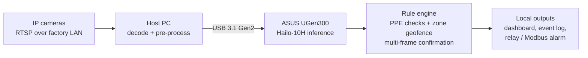

# AegisEdge: Privacy-First PPE and Restricted-Zone Alerts on ASUS UGen300

Entry for the **ASUS UGen AI League** · Theme: **Workplace AI** · Track: **Battlefield Lightning (Global Online Track)** · Team: **refrigerator1**

> **Project status: Stage I proposal.** This repository currently contains the plan, architecture and target metrics. The model, application and benchmarks will be built in Stage II on the ASUS UGen300 hardware. Nothing listed under "Targets" has been measured yet.

---

## 1. Overview

AegisEdge is an on-device vision system that watches camera feeds on manufacturing and construction sites and raises **local alerts** when it sees missing PPE (helmets, high-vis vests) or a person inside a restricted zone.

All inference runs on the **ASUS UGen300 USB AI Accelerator** attached to an ordinary host PC. Raw video is processed in memory and is never stored or sent off-site.

**AegisEdge is an advisory alert layer.** It supplements, and does not replace, certified safety PLCs, interlocks or emergency stops.

## 2. Problem

- Cameras on most sites record incidents for later review; they do not warn anyone in time.
- Manual supervision is affected by fatigue and coverage gaps.
- Cloud video analytics send worker footage off-site, which raises privacy and union concerns, adds network-dependent delay, and brings recurring GPU and bandwidth costs that grow with every camera.

**Question:** how can a site get real-time PPE alerts without sending video off-site?

## 3. Solution

| Principle | How AegisEdge applies it |
|---|---|
| Local-only processing | Detection runs on the UGen300; no cloud service is needed |
| Retrofit-friendly | USB connection, so existing host PCs and IP cameras can be reused |
| Privacy by design | In-memory frames, no face recognition, no worker identification |
| Measurable | Latency, accuracy and stability are benchmarked and published in this repo |

## 4. Target Hardware

| Item | Specification |
|---|---|
| Accelerator | ASUS UGen300 USB AI Accelerator (UGen300-USB-8G) |
| AI chip | Hailo-10H NPU, up to 40 TOPS (INT4) / 20 TOPS (INT8) |
| Memory | 8 GB LPDDR4 |
| Interface | USB 3.1 Gen2 Type-C (10 Gbps) |
| Typical power | ~2.5 W |

Specifications are taken from the ASUS UGen AI League material and the product page; please check the official datasheet for authoritative values.

## 5. System Architecture



1. **Input:** RTSP streams from IP cameras (USB cameras for development).
2. **Host pre-processing:** OpenCV decodes and resizes frames, then sends them to the accelerator through HailoRT.
3. **Inference:** a quantized YOLO-class detector runs on the Hailo-10H.
4. **Rule engine:** converts detections into events, with confidence thresholds and multi-frame voting to reduce false alarms.
5. **Output:** local dashboard (FastAPI + WebSocket), event log, and optional hardware alarm through a USB relay or Modbus.

## 6. Model and Methodology

- **Base model:** a YOLOv8n-class detector from the Hailo Model Zoo, fine-tuned on public PPE datasets.
- **Classes:** `person`, `helmet`, `vest`. We will compare this with directly training `no_helmet` and `no_vest` classes and keep whichever validates better.
- **Restricted zones** are polygons evaluated in the rule engine. They are not a detection class.
- **Quantization:** ONNX export, then Hailo Dataflow Compiler to a `.hef` file at INT8, using calibration images that resemble site conditions.
- **Validation:** report FP32 vs INT8 mAP on a held-out set, plus event-level recall and false-alarm rate on annotated test footage.
- **Licensing:** Ultralytics YOLOv8 is AGPL-3.0. Before any commercial use we will evaluate an Ultralytics enterprise license or a permissively licensed alternative model.

## 7. Privacy and Limitations

**Privacy by design**
- Frames are processed in memory only; they are not written to disk or transmitted.
- No facial recognition and no worker identification.
- Event logs contain timestamp, camera ID and violation type. Snapshots are optional and blurred.
- Log retention is configurable.

**Limitations**
- Not a certified functional-safety device and not the only safeguard on a site.
- Occlusion, backlight, dust and night scenes can reduce accuracy.
- Detection will produce some false alarms and misses; thresholds and human review of critical events are part of the design.

## 8. Targets for Stage II

These are planning goals. Measured results will replace this table with a benchmark report.

| Metric | Target | Method |
|---|---|---|
| NPU inference latency (INT8) | ≤ 20 ms, p95, including USB transfer | HailoRT timing on UGen300 |
| End-to-end alert latency | ≤ 500 ms, p95 | Camera event to alert output, including decode and 3-frame confirmation |
| Concurrent streams | ≥ 4 × 1080p @ 15 FPS | Log host CPU load |
| Accuracy (INT8) | mAP@0.5 ≥ 0.85; drop ≤ 2 points vs FP32 | Held-out PPE test set |
| Alert quality | Recall ≥ 90% on missing-PPE events; ≤ 1 false alarm per camera-hour | Annotated test footage |
| Accelerator power | ≤ 3 W average | USB power meter |
| Stability and privacy | 72 h continuous run; 0 frames stored or sent off-site | Soak test and packet capture |

## 9. Plan

| Period (2026) | Milestone |
|---|---|
| Nov 2 – 8 | Dataset preparation, FP32 baseline, Dataflow Compiler set up on a PC |
| Nov 9 – 15 | `.hef` compilation, INT8 calibration, first UGen300 benchmarks |
| Nov 16 – 22 | HailoRT multi-stream pipeline, rule engine, alert output |
| Nov 23 – 29 | FastAPI dashboard, full benchmarks, 72 h soak test |
| Nov 30 – Dec 4 | Demo video, README and architecture diagram finalization, submission |

**Deliverables:** compiled `.hef` model, Python HailoRT application, local monitoring dashboard, benchmark report.

## 10. Business Potential

- **Customers:** SME factories, construction subcontractors and warehouses that already have IP cameras and an on-site PC.
- **Value:** add a USB accelerator rather than replacing hosts; no cloud subscription; local-only processing eases privacy discussions with workers.
- **Model:** one-time hardware plus a per-site or per-camera software license. Stage II will quantify cost per camera against cloud video analytics.
- **Beyond PPE:** forklift-proximity and posture alerts on the same pipeline; optional on-device summaries of safety events (stretch goal).

## 11. Repository Structure

```
.
├── docs/        Stage I proposal deck (PDF)
├── models/      ONNX and Hailo-compiled (.hef) models (Stage II)
├── src/         Python application: HailoRT inference, rule engine, dashboard (Stage II)
├── data_prep/   Dataset plan, class mapping and licenses (scripts added in Stage II)
└── README.md
```

## 12. Getting Started

Setup instructions and run commands will be added in Stage II once the application exists.

Expected requirements: a host PC with a free USB 3.x port, the UGen300 driver and HailoRT installed, Python 3.10+, and an RTSP camera or video file for testing.

## 13. References

- ASUS UGen AI League rules and UGen300 platform page
- Hailo Model Zoo, HailoRT and Hailo Dataflow Compiler documentation
- Ultralytics YOLO documentation (ONNX export, AGPL-3.0 license)
- Datasets: Roboflow Universe PPE detection datasets, SH17 (PPE in manufacturing), Open Images V7 (person images). Licenses are verified before training.

## 14. Team

**refrigerator1**: ASUS UGen AI League 2026 (GitHub: [@beatz19960](https://github.com/beatz19960))
